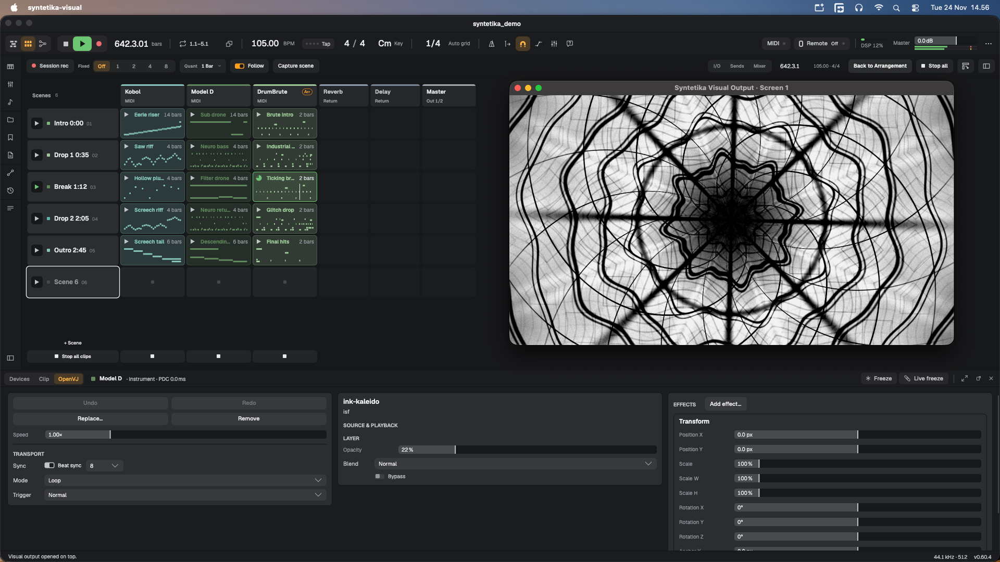

# Syntetika Engine

**Audio and visuals, on the same beat.**

Syntetika Engine is a live audio-visual workspace: Nota's Session view, with an openVJ visual on every clip. Launch a clip and its visual starts on the same musical beat — one performance surface for sound and picture.



> Status: **alpha (0.1.15)**. macOS Apple Silicon and Windows x64. Expect rough edges.
> What works, known limits and the roadmap: [docs/04-status-dan-rencana.md](docs/04-status-dan-rencana.md).
> Prioritas build macOS berikutnya (MIDI out, Session clips, mixer I/O): [docs/07-macos-prioritas.md](docs/07-macos-prioritas.md).

## Built on two excellent open-source projects

This project is an **integration**, not a new DAW or a new VJ engine:

| Project | What it is | Author / licence |
|---|---|---|
| [Nota](https://github.com/nota-daw/nota) | Cross-platform DAW: audio engine, Session/Arrangement, plugin hosting | © Egor Khindikaynen — **AGPL-3.0-only** |
| [openVJ](https://github.com/openwave-studio/openvj) | GPU VJ mixer: layers, ISF, video, mapping, Syphon | openwave-studio and contributors — **GPL-3.0-or-later** |

We did not write the DAW or the VJ engine. Our work is the bridge between them, released under
the same licences. **Not affiliated with or endorsed by either project.** Exact upstream
revisions and file-level changes are listed in [ATTRIBUTION.md](ATTRIBUTION.md).

## What we added

- **Beat-accurate launches** — NotA is the master clock; launches are scheduled on absolute
  beats, with a PLL so visual playback stays smooth even when the clock source is steppy.
- **Structure mirroring** — one openVJ layer per playable track, one column per scene, live
  add/remove/reorder, with stable track UIDs across save/reload.
- **Selection mirroring** — selecting a clip in NotA selects and previews it in openVJ.
- **OpenVJ tab** — the selected clip's visual parameters, transform and full effect chain,
  edited with Nota's own sliders; two-way with openVJ's UI.
- **One-file projects** — save a whole project (audio, visuals, media, version history) as a
  single `.syntetika` file; copy it to another Mac and open it. Legacy `.nota` folders still
  open and migrate on Save As.
- **Media sources** — generators, ISF, images, video (bundled decode-only FFmpeg), cameras and
  Syphon (Spout on Windows); media is copied into the project bundle so it travels with the project.
- **Video clips with sound in Nota** — drop a video on an audio Session slot: its audio is
  extracted into the slot and its picture becomes the slot's visual, beat-synced to the clip.
  Trimming the audio's start/end or looping it retimes and trims the video with it, with
  launches and stops on the same quantum (and phase-corrected) as the audio.
- **Always-on-top visual output** — View → Visual Output opens openVJ's output window above
  every other app at 480p; maximizing it means fullscreen, and Esc returns to the windowed output.
- **Projection mapping** — View → Projection Mapping opens openVJ's mapping editor for
  projector warping, slicing and masking, from inside Nota.
- **Clip copy/paste carries the visual** — copying, cutting, duplicating or dragging a Session
  clip also copies or moves its openVJ visual and media.
- **Scenes stay aligned** — inserting, removing, moving or duplicating scenes moves/copies the
  visual columns, and track reorders re-sync the selected slot.
- **Reconnect recovery** — a restarted visual engine reloads the project, then resumes the
  visuals of Session clips that are still playing.
- **Click-through launching** — clicking a clip in openVJ launches the matching Nota Session
  slot (audio and visual on the same quantum).
- **Paired video sound** — a video dropped on a visual slot also brings its audio into that
  Nota slot, unless the slot already has sound.
- **Audio-reactive visuals** — the visual engine analyses Nota's master output through a
  lock-free shared ring, so shaders, MilkDrop and audio-modulated parameters follow the DAW.
- **A/V offset & calibration** — View → A/V Offset shifts the picture ±200 ms with a beat
  strobe, so a projector or slow display lines up with the sound.
- **Visual undo/redo** — the OpenVJ tab has Undo/Redo for clip sources, parameters, playback,
  effects and layer settings; slider drags count as one step.
- **Performance** — hidden engine ~3% CPU (audio tap included), output-only ~24% at 60 fps; editor work is
  capped at 30 fps and the output path skips UI sync. View → Visual Performance selects Eco
  (30 fps, ~6.5% output), Balanced (45) or Quality (60). A visual that takes far over budget
  makes the engine render smaller (down to 12.5%) instead of freezing the app.
- **Background visual engine** — openVJ runs hidden by default; View → OpenVJ raises its
  editor once (not always-on-top), and while nothing is on screen it stops GPU rendering and
  slows its tick.
- **Persistence** — visuals are stored in the project bundle (`visuals/composition.json`) and
  restored with the track identity map.
- **Performance work** — static grid thumbnails, pipeline prewarm, and no GPU readback during
  a show.

## Run it

**macOS** (Apple Silicon):

```bash
open "./src/nota/dist/Syntetika Engine.app"
```

**Windows** (x64): run the installer from the
[releases page](https://github.com/danartriyudistira/syntetika-engine/releases/latest), or
build it yourself:

```powershell
powershell -ExecutionPolicy Bypass -File scripts/build-win.ps1
& src/nota/src/managed/Nota.App/bin/Release/net10.0/Nota.App.exe
```

The Windows installer is self-contained (no .NET needed) and installs per user by default.
Build/packaging details: [docs/05-windows.md](docs/05-windows.md).

Prebuilt macOS installers (Apple Silicon) are on the
[releases page](https://github.com/danartriyudistira/syntetika-engine/releases/latest); see
[docs/download.md](docs/download.md) for install, Gatekeeper and checksums.

The app starts its bundled visual engine (`Contents/Helpers/syntetika-visual` on macOS,
`syntetika-visual.exe` beside the app on Windows), restarts it if it crashes, and stops it
on quit. Then open **Session View**, select a clip, and use the **OpenVJ** tab to assign a
visual. Build instructions live in [docs/02-m0-setup.md](docs/02-m0-setup.md) and
[docs/05-windows.md](docs/05-windows.md).

Package a DMG (the bundle must be built first):

```bash
cd src/nota
bash scripts/bundle-mac.sh              # native engine + managed publish + .app
bash scripts/package-dmg-syntetika.sh   # dist/Syntetika-Engine-<version>-arm64.dmg
```

The image is ad-hoc signed, not notarized: on another Mac, right-click → **Open** once (or
System Settings → Privacy & Security → **Open Anyway**).

## Repository layout

```
src/nota/      fork of Nota (AGPL-3.0-only)
src/openvj/    fork of openVJ (GPL-3.0-or-later)
docs/          research, setup and bridge notes
patches/       our diffs against the upstream revisions
scripts/       build environment
```

## Data & migration

This build keeps its profile in `~/Library/Application Support/Syntetika Engine` on macOS and
`%APPDATA%\Syntetika Engine` on Windows. On first launch it copies an existing `NotAopenVJ`
profile once (macOS) and leaves the old folder untouched.

## Credits & licences

- Nota — © Egor Khindikaynen, AGPL-3.0-only. The Nota part of this repository remains AGPL.
- openVJ — openwave-studio and contributors, GPL-3.0-or-later. The openVJ part remains GPL.
- Integration layer and documentation — AGPL-3.0-only.
- Third-party notices (JUCE, Avalonia, Slint, FFmpeg, Ghost Arcade, fonts) are kept in each
  tree's `LICENSES/` and `THIRD_PARTY_NOTICES.md`; see [ATTRIBUTION.md](ATTRIBUTION.md).

“Nota” and “openVJ” are the marks of their respective owners and are used here descriptively.
